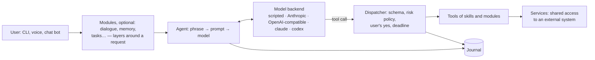

# Jericho

**🇬🇧 English** · [🇷🇺 Русский](README.ru.md)

[](https://github.com/Anach0ret/jericho-ai/actions/workflows/ci.yml)
[](https://github.com/Anach0ret/jericho-ai/actions/workflows/platforms.yml)
[](pyproject.toml)
[](LICENSE)

**A Python framework for building LLM assistants that act, not just answer.**

Build a personal assistant, an operations helper behind a chat bot, or a narrow one — a news analyst, an apartment
scout. You write the tools; the framework's code decides what a call may do: a risk policy for every tool, the
user's "yes" before anything irreversible, care with private data and foreign text, and an audit log of every call.

Jericho is a framework, not a ready-made app: each assistant is its own project with its own skills, settings and
role, and the framework is installed into it as a package. Develop on Linux, macOS or Windows; the full safety
guarantees are for Linux ([Platforms](#platforms)). The guides are in Russian for now.

[Quick start](#quick-start) · [Examples](#what-you-can-build) · [Architecture](#architecture) ·
[Security](docs/security.md) · [Docs](#documentation)


*A note is saved, bad parameters are refused, deleting everything waits for "yes", the journal shows each call.
Real commands in the tutorial project; a [scripted backend](docs/backends.md) stands in for the model, the policy,
the "yes" and the journal are the real framework ([`scripts/demo_cast.py`](scripts/demo_cast.py)).*

## What you can build

| Assistant | What it does | Status |
|---|---|---|
| **Personal desktop assistant** | voice and text: windows, files, Telegram, tasks, memory, scheduled requests; notifications with Yes/No buttons | runs daily (author's private project) |
| **Operations assistant behind a bot** | "what's up with the server?", "why does the webhook fail?" — log digests, explaining errors from the code; restarts and deploys only of what settings list, and only after "yes"; alerts without a model | runs daily (author's private project) |
| **Narrow analyst or scout** — news analyst, apartment scout | reads sources on a schedule, filters by your criteria, writes a report; anything that leaves the machine waits for "yes" | possible with the current framework; no ready-made package |
| **Assistant inside a service** | the service exposes its actions as tools (over its API or MCP); the user describes the outcome, the assistant turns it into tool calls on the user's behalf | the framework is still growing for it: web entry point, MCP bridge, user credentials in tools |

The tutorial assistant from the demo — notes with a "yes" before deleting — is built step by step in
[docs/first-assistant.md](docs/first-assistant.md) (in Russian).

## Quick start

You need Python 3.14 and [uv](https://docs.astral.sh/uv/). Develop on Linux, macOS or Windows; the full safety
guarantees are for Linux — see [Platforms](#platforms). The framework is installed from this repository by tag (the
name `jericho` on PyPI belongs to another package).

```bash
uvx --from git+https://github.com/Anach0ret/jericho-ai@v0.64.17 jericho startproject my-assistant
cd my-assistant
uv sync
uv run my_assistant ask "hello"      # the "scripted" backend: no model, no key
```

The first answer comes from the project's script file (`settings/script.yaml`) and is in Russian, like the rest of
the template; set `language = "en"` in the settings and what the framework says by itself — failures, "Cancelled",
the Yes/No buttons — is in English, and the model is told to reply in English.

Next:

- **Connect a model** — any OpenAI-compatible service (OpenRouter, Gemini, Ollama), the Anthropic API, or the
  `claude` / `codex` programs on your own subscription: [docs/backends.md](docs/backends.md). For example, with
  the `jericho-ai[openai]` extra, in `settings/base.py`:

  ```python
  from jericho.backends.openai_api.settings import OpenAiSettings

  class Base(Settings):
      agent: AgentSettings = AgentSettings(backend="jericho.backends.openai_api")
      openai_api: OpenAiSettings = OpenAiSettings(base_url="https://openrouter.ai/api/v1", model="…", api_key_env="OPENROUTER_API_KEY")
  ```

- **Write the first skill and tool** — `startskill`, `starttool` and the tutorial
  [docs/first-assistant.md](docs/first-assistant.md).

Tests, type checks and the pre-commit hook are for development — see [CONTRIBUTING.md](CONTRIBUTING.md).

## How it keeps the model in check

- **Every tool has a risk class.** `READ` and `NAVIGATE` run right away, `CHANGE` is reversible, `EFFECT`
  (irreversible or leaves the machine) runs only after the user says "yes". The "yes" is recognised by code from
  the user's own words, not by the model; it is single-use and bound to the named action. Unattended runs
  (scheduled tasks) never perform `EFFECT` unless the project allows a tool by name.
- **Private data and local files go only to a trusted model.** Fields with private correspondence are not written to
  the journal (crash records included); they and the contents of local files by default reach only the main model; a
  fallback gets them only if listed in
  `agent.private_backends` ([example](docs/backends.md#запасные-бэкенды)). After private data — or after a local
  file, if the same phrase also brought foreign text — anything that leaves the machine needs a "yes".
- **Foreign text is tracked.** Web pages, emails and program output are marked as foreign: instructions inside them
  are not commands.
- **Every call is journaled**: tool, parameters, outcome, timing, on whose behalf.
- **Skills can be written by an AI agent.** Scaffolds (`startskill`, `starttool`) and structure checks (`check`,
  E001–E016) keep the architecture from being broken silently: every rule ships with a check.

What is guaranteed, by whom and how it is tested — and what is *not* promised — is in
[docs/security.md](docs/security.md). Most importantly, this is **not a sandbox** for untrusted code: the framework
constrains the model; skill code is trusted — written or reviewed by a human.

A tool declares its contract; the framework enforces it:

```python
class SendReport(Tool[SendReportRequest]):
    name = "send_report"
    request_type = SendReportRequest
    risk = Risk.EFFECT            # leaves the machine: refused when nobody can say "yes"
    approval = Approval.ASK       # the framework asks for "yes" before the call (EFFECT must name it — check E008)
    description = ToolDescription(
        when="the user asks to send the report to a client.",
        does="emails the finished report to the address on the client's card.",
        returns='{"ok": true, "sent_to": address}.',
        refusals="no_report — there is no report yet: call build_report first.",
    )

    def _run(self, request: SendReportRequest) -> ToolResult:
        ...
        return ToolResult.success(sent_to=address)
```

The model sees the name, the description and the parameter schema. Bad parameters, a tool whose skill isn't
loaded, `EFFECT` without a "yes", a request whose time is already up — each is refused with a code before the tool
does anything. A running tool that misses its deadline is cut off (`tool_timeout`): what it managed to do is unknown,
and the model is told not to repeat the call.

## Architecture



The project lists in its settings what is switched on:

```python
class Base(Settings):
    INSTALLED_SERVICES: tuple[str, ...] = ("my_assistant.services.windows",)   # shared access to one external system
    INSTALLED_MODULES: tuple[str, ...] = ("jericho.modules.voice", "jericho.modules.dialogue")
    TASK_MIDDLEWARE: tuple[str, ...] = ("jericho.modules.dialogue",)            # layers around a request, in order
    INSTALLED_SKILLS: tuple[str, ...] = ("my_assistant.skills.desktop",)
    PROMPT_SECTIONS: tuple[str, ...] = ("my_assistant.settings:prompt/role.md", "jericho.core.prompting:sections/skills.md", ...)
    agent: AgentSettings = AgentSettings(backend="jericho.backends.anthropic_api")
```

| Folder | What's inside |
|---|---|
| `src/jericho/core/` | the tool and the policy around its call, skills, the request flow, prompt, settings and assembly, journal, confirmations, checks, phrase evals |
| `src/jericho/modules/` | optional modules that join the request flow: `voice`, `dialogue`, `memory`, `notes`, `journal_reader`, `tasks`, `plans`, `playbooks`, `inbox`, `files`, `search`, `scripts` |
| `src/jericho/backends/` | model backends: `scripted` — no model; `anthropic_api` and `openai_api` — by key; `claude_cli` and `codex_cli` — the `claude` / `codex` programs on your subscription |

Every project gets the commands `ask`, `stop`, `model`, `prompt`, `log`, `status`, `check`, `eval`, `startskill`,
`starttool`, `startservice`; with the `tasks` module also `task <name>` and `timers install|list|remove`.

### What Jericho is not

- **Not a prompt chain or an agent graph.** The model drives the request; Jericho owns the contract of each tool —
  risk class, consent, journal.
- **Not just a way to give a model tools.** Tool calling and MCP connect tools to a model; Jericho adds a policy on
  top of the tools that settings can't switch off, plus tracking of foreign text and private data. (For the `claude`
  and `codex` backends the framework runs its own MCP server with the project's tools.)
- **Not a platform for thousands of users.** Each request is a separate process, state lives in files. For yourself
  and a team — yes; for a mass-market service — no.

## Platforms

Assistants built on Jericho mostly run on a server or in a container, so there are two levels:

- **Development — Linux, macOS and Windows.** Create a project, write skills, services and modules, run the
  assistant locally, check the logic, the "yes", errors and the model, run tests. CI runs the framework's tests on
  all three.
- **Full safety guarantees — Linux** (on another machine — Linux in a container): tool deadline, stopping a program
  tree, private files. A local run on macOS or Windows does not prove them. The table of what holds where is
  "Платформы" in [docs/security.md](docs/security.md#платформы).

Linux batteries — voice, D-Bus notifications (`notify`, the `desktop` extra), tasks on systemd timers (`tasks`) —
are optional modules: leave them out on another OS and fake them in tests.

## Status

Version 0.x: young and still changing; what is public and how versions change is in
[docs/stability.md](docs/stability.md). The documentation and the core prompt are in **Russian** for now; with
`language = "en"` the assistant replies in English, and "yes"/"no" ("okay", "go ahead", "nope"…) are understood in
both languages either way. A personal project: issues are answered when possible, no guarantees on timing.

## Documentation

All documents are in Russian.

- **First assistant, step by step:** [docs/first-assistant.md](docs/first-assistant.md)
- **Security model:** [docs/security.md](docs/security.md) · **decisions index:** [docs/decisions.md](docs/decisions.md)
- **What is public and how versions change:** [docs/stability.md](docs/stability.md)
- Tool contract — [docs/tools.md](docs/tools.md) · structure checks — [docs/checks.md](docs/checks.md) ·
  backends — [docs/backends.md](docs/backends.md) · eval phrases — [docs/evals.md](docs/evals.md) ·
  unattended tasks — [docs/tasks.md](docs/tasks.md) · requests through a bot — [docs/inbox.md](docs/inbox.md)
- Reporting a vulnerability — [SECURITY.md](SECURITY.md) · contributing — [CONTRIBUTING.md](CONTRIBUTING.md)

## License

[Apache License 2.0](LICENSE). The `claude_cli` backend works through your own Claude subscription — for your
personal assistant only; Anthropic's terms are in
[docs/backends.md](docs/backends.md#подписка-claude-и-условия-anthropic). For anything other people use, use an API key.
