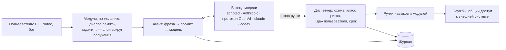

# Jericho

[🇬🇧 English](README.md) · **🇷🇺 Русский**

[](https://github.com/Anach0ret/jericho-ai/actions/workflows/ci.yml)
[](https://github.com/Anach0ret/jericho-ai/actions/workflows/platforms.yml)
[](pyproject.toml)
[](LICENSE)

**Python-каркас для LLM-ассистентов, которые действуют, а не только отвечают.**

На нём строят личного ассистента, помощника для эксплуатации через бота или узкого — аналитика новостей, маклера.
Ручки (инструменты) пишете вы; что вызову можно, решает код каркаса: класс риска у каждой ручки, «да» пользователя
перед необратимым, осторожность с личными данными и чужим текстом, журнал каждого вызова.

Jericho — каркас, а не готовая программа: каждый ассистент — отдельный проект со своими навыками, настройками и
ролью, а каркас ставится в него пакетом. Разрабатывать можно на Linux, macOS и Windows; полные гарантии
безопасности — для Linux ([Платформы](#платформы)).

[Быстрый старт](#быстрый-старт) · [Примеры](#что-можно-построить) · [Устройство](#устройство) ·
[Безопасность](docs/security.md) · [Документы](#документы)


*Заметка записана, неверные параметры — отказ, стирание всего ждёт «да», журнал показывает каждый вызов.
Команды настоящие, на проекте из руководства; вместо модели — [бэкенд-сценарий](docs/backends.md), политика, «да» и
журнал — настоящий каркас ([`scripts/demo_cast.py`](scripts/demo_cast.py)).*

## Что можно построить

| Ассистент | Что делает | Готовность |
|---|---|---|
| **Личный ассистент** на рабочем столе | голосом и текстом: окна, файлы, Telegram, дела, память, поручения по расписанию; уведомления с кнопками «Да/Нет» | работает каждый день (личный проект автора) |
| **Ассистент для эксплуатации** через бота | «что с сервером?», «в чём ошибка вебхука?» — разбор журналов, объяснение ошибок по коду; перезапуск и выкатка — только названного в настройках и после «да»; тревоги без модели | работает каждый день (личный проект автора) |
| **Узкий аналитик или поисковик** — аналитик новостей, маклер | по расписанию читает источники, отбирает по вашим условиям, пишет отчёт; всё, что уходит наружу, ждёт «да» | можно собрать на нынешнем каркасе; готовой поставки нет |
| **Ассистент внутри сервиса** | сервис открывает ассистенту свои действия ручками (поверх своего API или MCP); пользователь описывает результат, ассистент раскладывает его на вызовы ручек от имени пользователя | каркас для этого ещё растёт: вход из веба, мост к MCP, права пользователя в ручке |

Ассистент из демо — заметки с «да» перед стиранием — собирается пошагово в
[docs/first-assistant.md](docs/first-assistant.md).

## Быстрый старт

Нужны Python 3.14 и [uv](https://docs.astral.sh/uv/). Разрабатывать можно на Linux, macOS и Windows; полные
гарантии безопасности — для Linux, см. [Платформы](#платформы). Каркас ставится из этого репозитория по метке версии
(имя `jericho` в PyPI занято другим пакетом).

```bash
uvx --from git+https://github.com/Anach0ret/jericho-ai@v0.64.17 jericho startproject my-assistant
cd my-assistant
uv sync
uv run my_assistant ask "привет"      # бэкенд «сценарий»: без модели и без ключа
```

Первый ответ берётся из файла сценария проекта (`settings/script.yaml`). С `language = "en"` в настройках то, что
каркас говорит сам (сбои, «Отменил», кнопки «Да/Нет»), — по-английски, и модель просят отвечать по-английски.

Дальше:

- **Подключить модель** — любой сервис с протоколом OpenAI (OpenRouter, Gemini, Ollama), Anthropic API или
  программы `claude` / `codex` по вашей подписке: [docs/backends.md](docs/backends.md). Например, с зависимостью
  `jericho-ai[openai]`, в `settings/base.py`:

  ```python
  from jericho.backends.openai_api.settings import OpenAiSettings

  class Base(Settings):
      agent: AgentSettings = AgentSettings(backend="jericho.backends.openai_api")
      openai_api: OpenAiSettings = OpenAiSettings(base_url="https://openrouter.ai/api/v1", model="…", api_key_env="OPENROUTER_API_KEY")
  ```

- **Написать первый навык и ручку** — `startskill`, `starttool` и руководство
  [docs/first-assistant.md](docs/first-assistant.md).

Тесты, проверка типов и хук перед коммитом — для разработки, см. [CONTRIBUTING.md](CONTRIBUTING.md).

## Как каркас держит модель

- **У каждой ручки — класс риска.** `READ` и `NAVIGATE` идут сразу, `CHANGE` — поправимое, `EFFECT` (не отменить
  или уходит наружу) — только после «да» пользователя. «Да» распознаёт код по фразе человека, а не модель; оно
  действует один раз и только на названное действие. Без человека (по расписанию) `EFFECT` не выполняется — кроме
  ручек, которые проект разрешил поимённо.
- **Личные данные и файлы с машины — только доверенной модели.** Поля с перепиской не пишутся в журнал (и в аварийную
  запись); они и содержимое файлов с машины по умолчанию достаются только основной модели; запасной — только если назвать её в `agent.private_backends`
  ([пример](docs/backends.md#запасные-бэкенды)). После личного или после файла с машины, если в той же фразе был
  чужой текст, вынести что-то наружу можно только с «да».
- **Чужой текст учитывается.** Страница, письмо, вывод программы помечены как чужие — указания из них не команда.
- **Каждый вызов — в журнале**: ручка, параметры, итог, время, чьё поручение.
- **Навыки может писать ИИ-агент.** Заготовки (`startskill`, `starttool`) и проверки структуры (`check`,
  E001–E016) не дают молча нарушить архитектуру: правило приходит вместе с проверкой.

Что именно гарантируется, кем и чем проверено, — [docs/security.md](docs/security.md); там же честный список того,
чего каркас **не** обещает. Главное из него: это **не песочница** для непроверенного кода — каркас ограничивает
модель, а код навыков доверенный: его пишет или принимает человек.

Ручка объявляет договор, каркас его держит:

```python
class SendReport(Tool[SendReportRequest]):
    name = "send_report"
    request_type = SendReportRequest
    risk = Risk.EFFECT            # уходит наружу: без человека — отказ
    approval = Approval.ASK       # «да» до вызова спрашивает каркас (у EFFECT обязательно назвать — проверка E008)
    description = ToolDescription(
        when="просят отправить отчёт клиенту.",
        does="отправляет готовый отчёт письмом на адрес из карточки клиента.",
        returns='{"ok": true, "sent_to": адрес}.',
        refusals="no_report — отчёта ещё нет: сначала build_report.",
    )

    def _run(self, request: SendReportRequest) -> ToolResult:
        ...
        return ToolResult.success(sent_to=address)
```

Модель видит имя, описание и схему параметров. Неправильные параметры, ручка без загруженного навыка, `EFFECT` без
«да», срок поручения уже вышел — отказ с кодом раньше, чем ручка что-то сделает. Ручку, не уложившуюся в свой срок,
каркас обрывает (`tool_timeout`): что она успела, неизвестно, и модели велено не повторять вызов.

## Устройство



Проект называет в настройках, что включено:

```python
class Base(Settings):
    INSTALLED_SERVICES: tuple[str, ...] = ("my_assistant.services.windows",)   # общий доступ навыков к одной внешней системе
    INSTALLED_MODULES: tuple[str, ...] = ("jericho.modules.voice", "jericho.modules.dialogue")
    TASK_MIDDLEWARE: tuple[str, ...] = ("jericho.modules.dialogue",)            # слои вокруг поручения, по порядку
    INSTALLED_SKILLS: tuple[str, ...] = ("my_assistant.skills.desktop",)
    PROMPT_SECTIONS: tuple[str, ...] = ("my_assistant.settings:prompt/role.md", "jericho.core.prompting:sections/skills.md", ...)
    agent: AgentSettings = AgentSettings(backend="jericho.backends.anthropic_api")
```

| Папка | Что в ней |
|---|---|
| `src/jericho/core/` | ручка и политика вокруг её вызова, навык, сценарий поручения, промпт, настройки и сборка, журнал, подтверждения, проверки, прогон фраз |
| `src/jericho/modules/` | модули — необязательное, что встаёт в путь поручения: `voice`, `dialogue`, `memory`, `notes`, `journal_reader`, `tasks`, `plans`, `playbooks`, `inbox`, `files`, `search`, `scripts` |
| `src/jericho/backends/` | бэкенды модели: `scripted` — без модели; `anthropic_api` и `openai_api` — по ключу; `claude_cli` и `codex_cli` — программы `claude` / `codex` по вашей подписке |

Команды у любого проекта: `ask`, `stop`, `model`, `prompt`, `log`, `status`, `check`, `eval`, `startskill`,
`starttool`, `startservice`; с модулем `tasks` — ещё `task <имя>` и `timers install|list|remove`.

### Чем это не является

- **Не цепочка промптов и не граф агента.** Ход поручения ведёт модель; Jericho держит договор каждой ручки — класс
  риска, согласие, журнал.
- **Не просто способ дать модели инструменты.** Вызов инструментов и MCP подключают ручки к модели; Jericho добавляет
  поверх ручек политику, которую нельзя отключить настройкой, и учёт чужого текста и личных данных. (Для бэкендов
  `claude` и `codex` каркас сам поднимает сервер MCP с ручками проекта.)
- **Не платформа для тысяч пользователей.** Поручение — отдельный процесс, состояние — в файлах. Для себя и для
  команды — да; для массового сервиса — нет.

## Платформы

Ассистенты на Jericho чаще всего работают на сервере или в контейнере, поэтому два уровня:

- **Разработка — Linux, macOS и Windows.** Создать проект, писать навыки, службы и модули, запускать ассистента
  локально, проверять логику, «да», ошибки и работу с моделью, гонять тесты. CI гоняет тесты каркаса на всех трёх.
- **Полные гарантии безопасности — Linux** (на другой машине — Linux в контейнере): срок ручки, остановка дерева
  программ, закрытые файлы. Локальный прогон на macOS или Windows их не доказывает. Что где выполняется — таблица
  «Платформы» в [docs/security.md](docs/security.md#платформы).

Батарейки под Linux — голос, уведомления по D-Bus (`notify`, extra `desktop`), задачи на таймерах systemd (`tasks`) —
необязательные модули: на другой ОС их не включают, а в тестах подменяют.

## Статус

Версия 0.x: каркас молод и ещё меняется — что публично и как меняются версии, в
[docs/stability.md](docs/stability.md). Документация и промпт ядра — на русском; с `language = "en"` ассистент
отвечает по-английски, а «да» и «нет» («okay», «go ahead», «nope»…) слышатся на обоих языках при любой настройке.
Это личный проект: на вопросы и issues автор отвечает по возможности, без сроков.

## Документы

- **Первый ассистент — пошагово:** [docs/first-assistant.md](docs/first-assistant.md)
- **Модель безопасности:** [docs/security.md](docs/security.md) · **где что решено:** [docs/decisions.md](docs/decisions.md)
- **Что публично и как меняются версии:** [docs/stability.md](docs/stability.md)
- Договор ручки — [docs/tools.md](docs/tools.md) · правила структуры — [docs/checks.md](docs/checks.md) ·
  бэкенды — [docs/backends.md](docs/backends.md) · проверочные фразы — [docs/evals.md](docs/evals.md) ·
  задачи без человека — [docs/tasks.md](docs/tasks.md) · поручения через бота — [docs/inbox.md](docs/inbox.md)
- Как сообщить об уязвимости — [SECURITY.md](SECURITY.md) · как предложить изменение — [CONTRIBUTING.md](CONTRIBUTING.md)

## Лицензия

[Apache License 2.0](LICENSE). Бэкенд `claude_cli` работает через вашу подписку Claude — только для вашего личного
ассистента; условия Anthropic — в [docs/backends.md](docs/backends.md#подписка-claude-и-условия-anthropic). Для
того, чем пользуются другие люди, — ключ API.
